# 12-DOF Quadruped Robotic Platform

### Design, Simulation & Validation for Fabrication

A **12-degree-of-freedom quadruped robot** developed and validated through CAD design, structural finite element analysis (FEA), inverse kinematics, URDF/PyBullet simulation, gait testing, and IMU-based posture stabilization. This repository documents the **simulation-validation stage before prototype fabrication**; the results reported here are from simulations, not physical hardware tests.

[**Read the full design validation report (PDF)**](Quadruped_Design_Validation_Report_Updated.pdf) · [**Watch forward crawl simulation**](https://drive.google.com/file/d/1icYhJY385csE4f64TvMkRzeLU5wFtsxe/view?usp=sharing) · [**Watch turning simulation**](https://drive.google.com/file/d/18FGKEcaTgiQZbJDWVjHjFIrQXt_vnNxh/view?usp=sharing)

## Project overview

The robot uses a symmetric four-legged configuration with **three degrees of freedom per leg (12 DOF total)**. The design aims to keep the center of mass (CoM) near the chassis center and uses support-leg shifts to improve stability during locomotion.

**Tools and technologies documented in the report:** Fusion 360 (CAD), SolidWorks (FEA), MATLAB (inverse kinematics), URDF and PyBullet (robot simulation), and a simulated IMU for posture feedback. The standing validation considers **MG996R servo torque limits**.

## 1. CAD design

The quadruped assembly was designed in Fusion 360, with symmetric leg placement and a centrally located chassis.

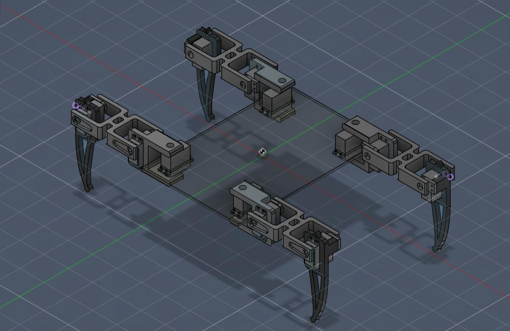

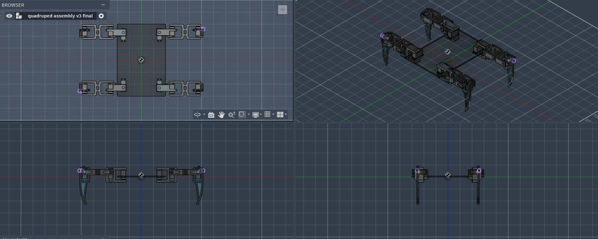

## 2. Structural validation (FEA)

SolidWorks static analysis modeled an **acrylic base plate** and **PLA structural members**, with the legs treated as fixed supports and gravitational loading representing the robot and onboard electronics.

- **Reported maximum deformation:** approximately **1.77 mm**, near the center of the base plate.
- The report concludes that the structure is mechanically viable for prototype fabrication; the factor-of-safety analysis serves as a baseline for potential reinforcement.

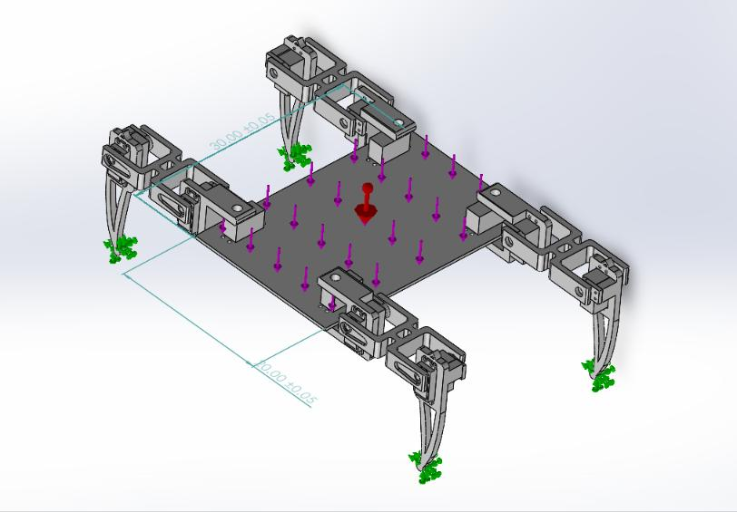

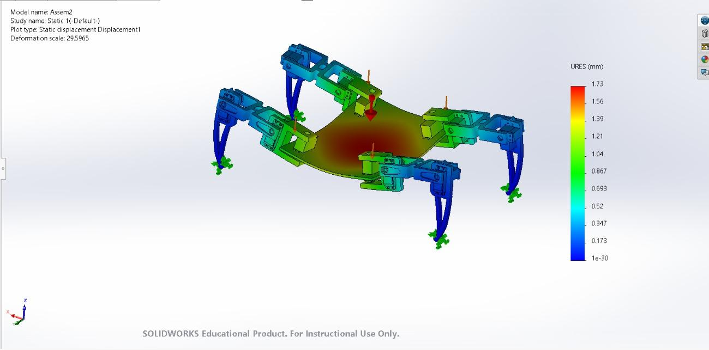

## 3. MATLAB inverse kinematics

The inverse kinematics (IK) model checks whether target foot coordinates correspond to joint angles within servo limits. Unreachable configurations are flagged in red in the interface.

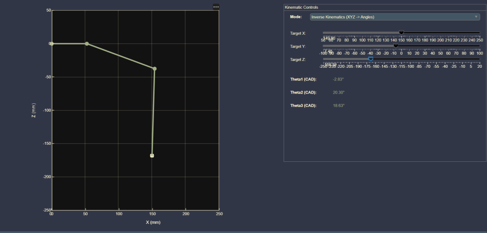

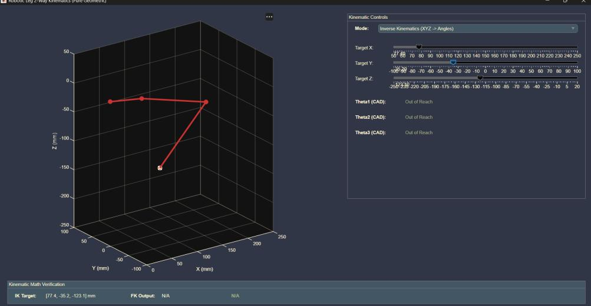

## 4. URDF and PyBullet validation

The exported URDF single-leg model was tested in PyBullet to verify that IK-derived joint commands produce the expected virtual leg motion.

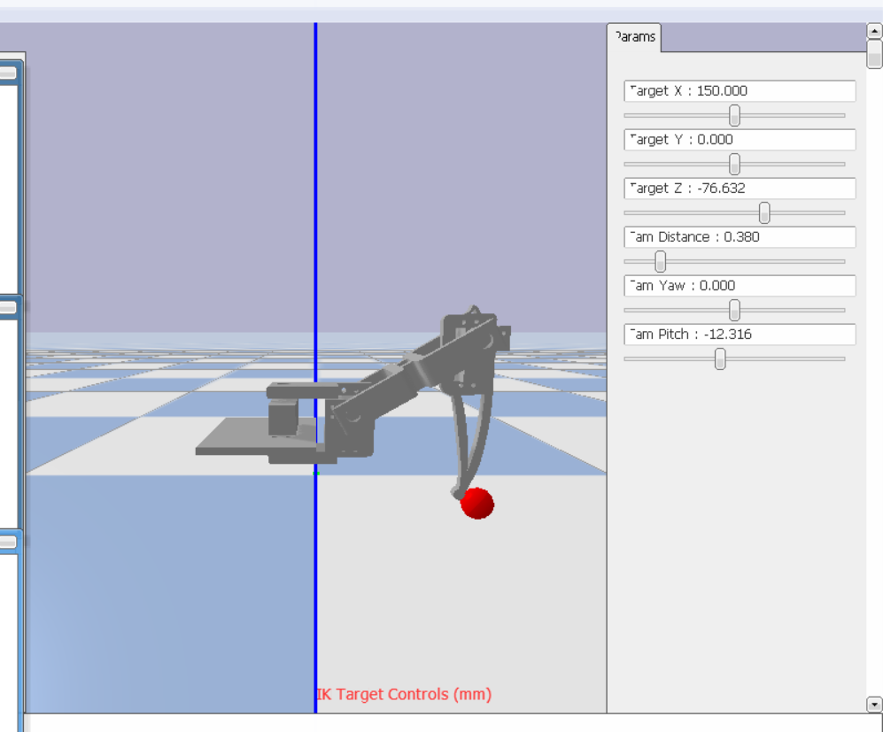

## 5. Static standing validation

A free-base standing simulation assessed whether the robot could support its weight within the available MG996R torque limit. The reported diagnostics passed the tested criteria:

| Metric | Reported result | Outcome |
| --- | ---: | --- |
| Ground clearance | 0.1308 m | Pass |
| Post-settle sag/drift | 0.0000 m | Pass |
| Maximum roll | 0.00° | Pass |
| Maximum pitch | 0.00° | Pass |
| Maximum joint error | 0.00° | Pass |

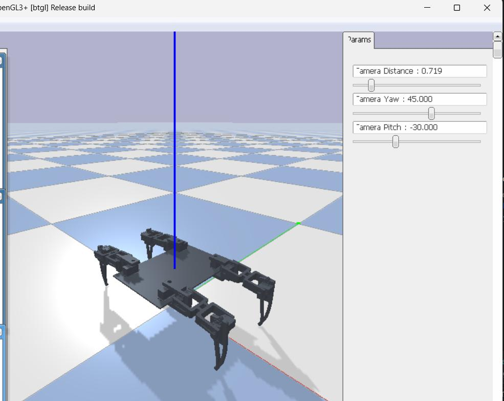

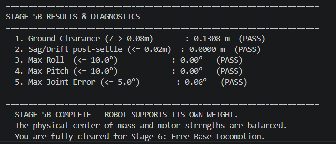

## 6. Forward crawl gait with CoM stabilization

A continuous forward crawl gait was evaluated in free-base simulation. The robot shifts its center of mass toward the supporting legs before lifting a swing leg, improving the support configuration and reducing the risk of toppling on flat ground.

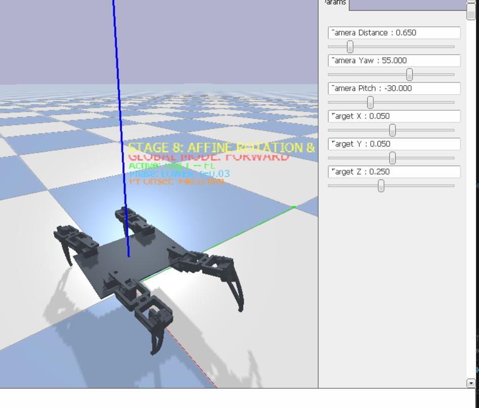

**[▶ Watch the forward crawl gait simulation](https://drive.google.com/file/d/1icYhJY385csE4f64TvMkRzeLU5wFtsxe/view?usp=sharing)**

> The video link above was extracted from the clickable image in page 7 of the supplied report. GitHub README files cannot reliably embed Google Drive videos as inline playable media; the link opens the video externally.

## 7. Differential turning gait

The turning gait uses a differential stance-sweep mechanism: left and right legs move in opposite directions to generate yaw while maintaining support.

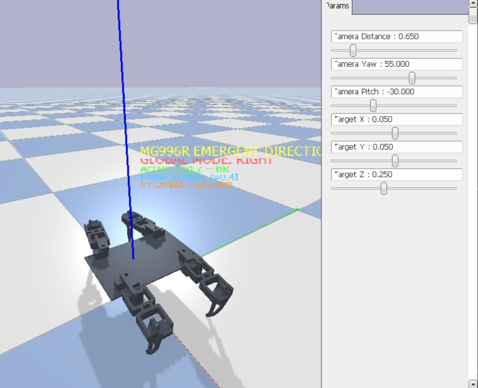

**[▶ Watch the turning gait simulation](https://drive.google.com/file/d/18FGKEcaTgiQZbJDWVjHjFIrQXt_vnNxh/view?usp=sharing)**

## 8. Unified simulation framework

The unified simulator combines forward walking, left/right turning, and stopping within one interface, allowing locomotion modes to be switched during a single runtime.

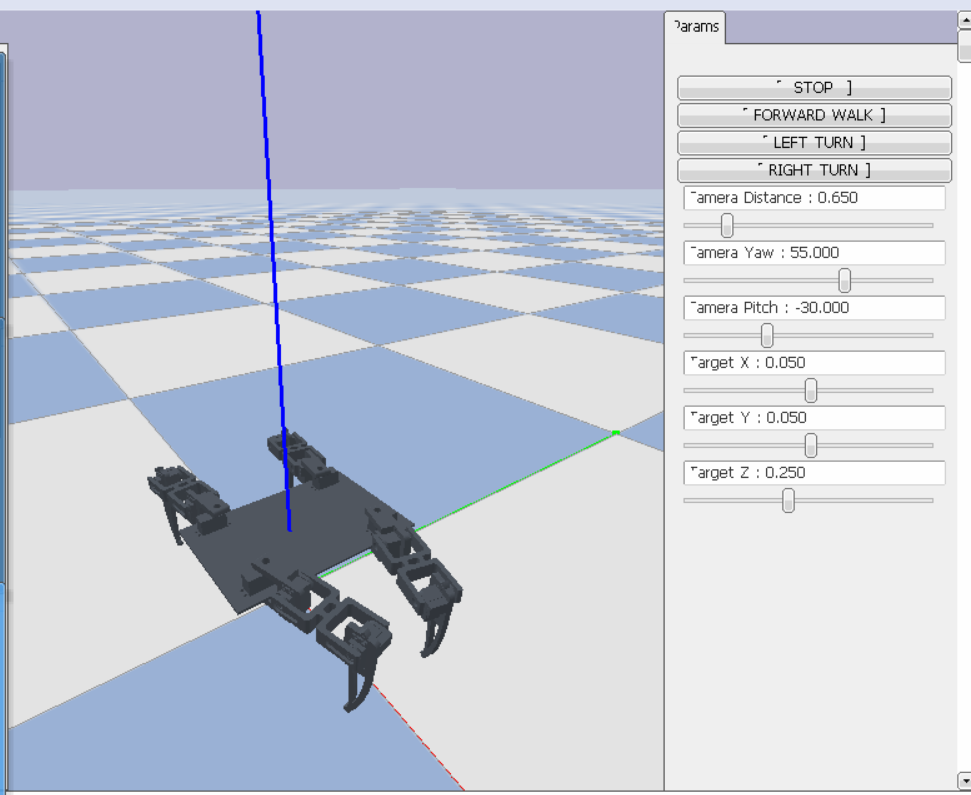

## 9. IMU-based roll and pitch stabilization

A simulated IMU provides roll, pitch, yaw, and angular-velocity telemetry. A posture controller generates corrective vertical leg adjustments based on measured body orientation to stabilize **roll and pitch** during locomotion and turning. The control architecture is intended for later transfer to hardware.

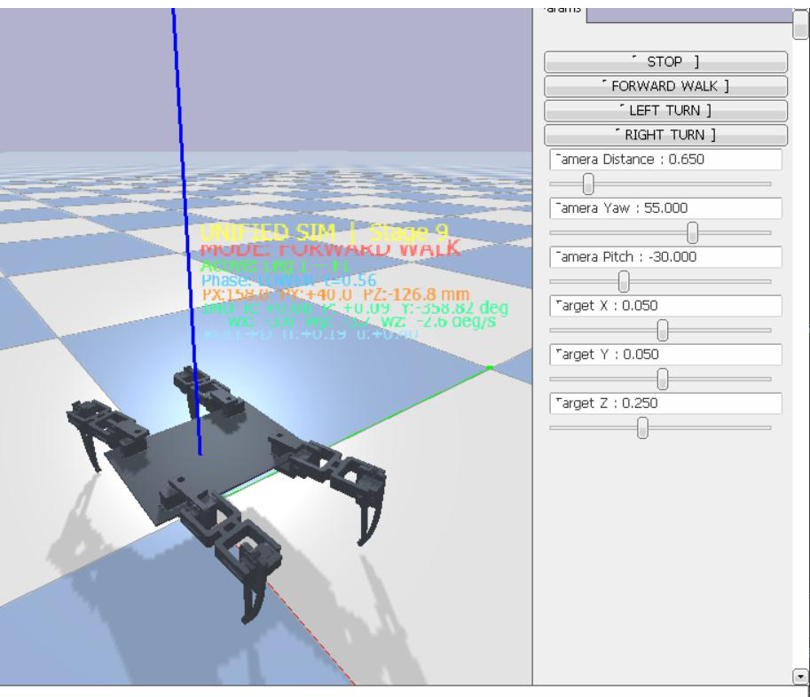

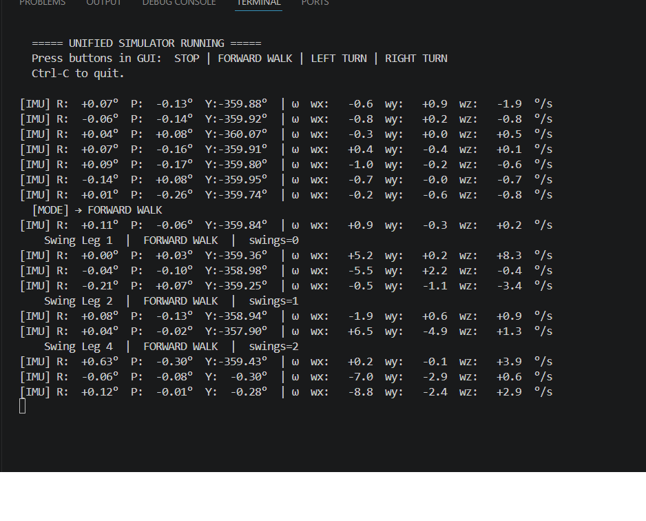

## Validation summary

| Validation module | Status reported |
| --- | --- |
| Structural FEA | Completed and validated |
| MATLAB inverse kinematics | Completed and validated |
| URDF / PyBullet single-leg simulation | Completed and validated |
| Static standing | Completed and validated |
| Forward crawl gait | Completed and validated |
| Differential turning gait | Completed and validated |
| Unified simulator | Completed and validated |
| Simulated IMU integration | Completed and validated |
| Roll stabilization | Integrated and validated |
| Pitch stabilization | Integrated and validated |

## Simulation videos

| Simulation | Video | Source |
| --- | --- | --- |
| Forward crawl gait with CoM compensation | [Watch on Google Drive](https://drive.google.com/file/d/1icYhJY385csE4f64TvMkRzeLU5wFtsxe/view?usp=sharing) | Report, page 7 |
| Differential turning gait | [Watch on Google Drive](https://drive.google.com/file/d/18FGKEcaTgiQZbJDWVjHjFIrQXt_vnNxh/view?usp=sharing) | Report, page 8 |

These are the **two clickable external video links embedded in the supplied PDF**. Other simulations are represented by screenshots in the report, but no additional video URLs were embedded.

## Repository media layout

```text
.
├── README.md
├── Quadruped_Design_Validation_Report_Updated.pdf
└── assets/
    └── images/
        ├── cad-assembly.jpeg
        ├── cad-multiview.jpeg
        ├── fea-load-setup.jpeg
        ├── fea-displacement.jpeg
        ├── matlab-ik-valid.png
        ├── matlab-ik-unreachable.jpeg
        ├── urdf-single-leg.png
        ├── static-standing.jpeg
        ├── standing-diagnostics.png
        ├── forward-crawl.jpeg
        ├── turning-gait.jpeg
        ├── unified-simulator.png
        ├── imu-stabilization.png
        └── imu-telemetry.png
```

The README uses **relative image paths**. Upload the `assets/images/` directory alongside `README.md` so the images render correctly on GitHub. Existing project source-code files can remain in the repository as they are.

## Next steps

The simulation pipeline has been validated as a basis for **fabrication and hardware integration**. Next steps include prototype fabrication, actuator/electronics integration, and verifying simulated performance on the physical robot.

---

**Source:** *Design Validation Report — 12-DOF Quadruped Robotic Platform (Simulation Validation Report for Fabrication Approval).* All images are extracted from the supplied report. Validation results describe the reported simulation tests.
